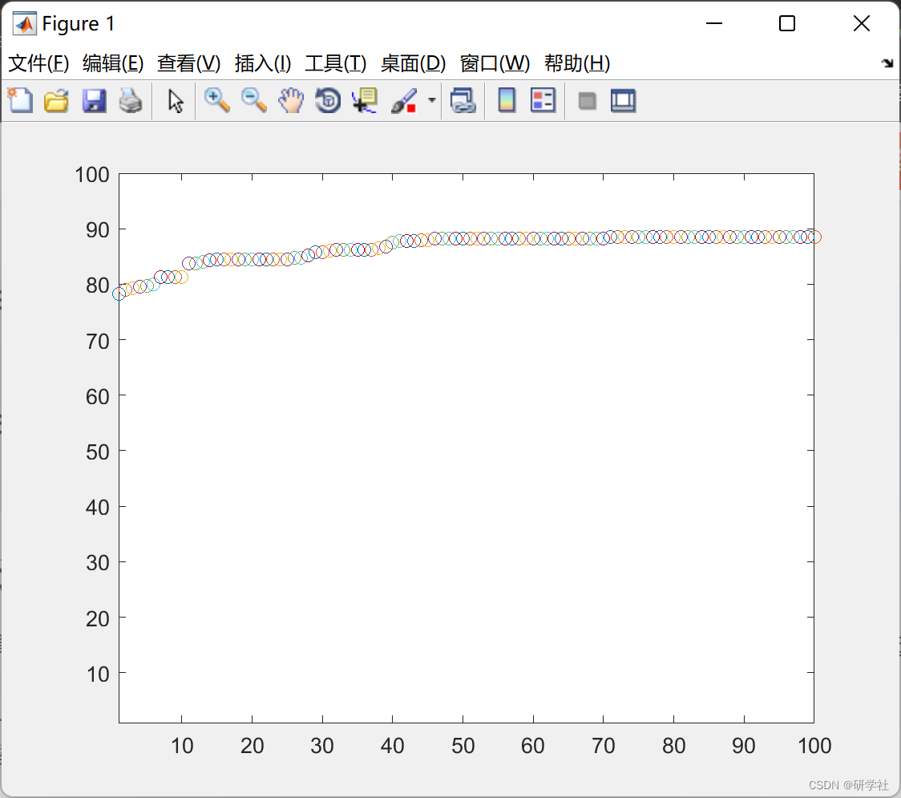

# Feature selection based on genetic algorithm and cuckoo search optimization algorithm (Matlab code implementation)

🏆 Bloggers' Advantages: 🌞🌞🌞 The content of the blog strives to be rigorous in thought and clear in logic, for the convenience of readers.
⛳️ Mantra: "Those who travel a hundred miles may arrive at only half of their destination." 📜
💥1 Overview of this paper, which combines genetic algorithms (GA) and cuckoo search optimization (CSO) for feature selection to maximize classification accuracy.
No Levy flight was used, instead, the GA species and mutations were used to update the robins. Naive Bayes classification was used in the code, but it can be replaced with any other classifier.
📚2 Running Results Editing
Main function code:
clear all;  
close all;  
clc;  
%%  
load data.mat  
n=5; % # of nests  
c=5; % # of cuckoos  
Pa=0.25; % a fraction of worst solutions  
Nf=size(data,2); % # of features  
worstN=round(Pa*n);  
for i=1:n  
solutions{i}=make_solution(Nf);  
end  
max_generation=100;  
for i=1:c  
cuckoo_solution{i}=make_solution(Nf);  
end  
for t=1:max_generation  
clc  
disp(['Searching...',num2str(t/max_generation*100),'%']);  
index=randsrc(1,c,1:n);  
for i=1:c  
if fitf(cuckoo_solution{i})>fitf(solutions{index(i)})  
solutions{index(i)}=cuckoo_solution{i};  
end  
end  
for i=1:n  
fitness(i)=fitf(solutions{i});  
end  
[~,idx]=sort(fitness);  
plot(t,fitness(idx(end)),'o');  
hold on  
xlim([1 max_generation]);  
ylim([1 100]);  
pause(0.00001);  
best_solution=solutions{idx(end)};  
best_solution2=solutions{idx(end-1)};  
wrst=idx(1:worstN);  
for i=1:length(wrst)  
solutions{wrst(i)}=make_solution(Nf);  
end  
for i=1:c  
cuckoo_solution{i}=GASearch(best_solution,best_solution2,Nf); % Genetic Algorithm Search  
end  
end  
🎉3 References
🌈4 Matlab code implementation

## Images

<!-- PAYMENT_BLOCK -->

## Get this dataset

- Payment link (Stripe): [Buy now](https://buy.stripe.com/3cs8yP7sY87d0vu9AB)
- Payment QR code: 

<!-- /PAYMENT_BLOCK -->
